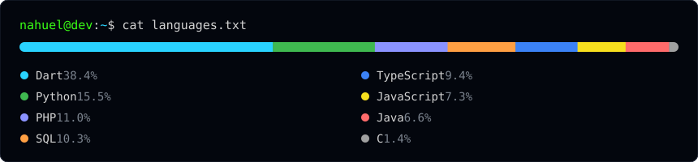

  

  
  &nbsp;&nbsp;
  

## Tech stack

<table align="center">
  <tr>
    <td><b>Web</b></td>
    <td>      </td>
  </tr>
  <tr>
    <td><b>Python</b></td>
    <td>   </td>
  </tr>
  <tr>
    <td><b>Mobile</b></td>
    <td>   </td>
  </tr>
  <tr>
    <td><b>Data</b></td>
    <td>   </td>
  </tr>
  <tr>
    <td><b>Also</b></td>
    <td>    </td>
  </tr>
  <tr>
    <td><b>Deploy & tools</b></td>
    <td>     </td>
  </tr>
</table>

  

Counted across all my repos, private ones included. HTML, CSS and the native code Flutter generates are left out. Updated by hand with <code>scripts/lenguajes.py</code>.

## Projects

Most of these are live sites for places in San Antonio, Paraguay. The repos are private, but you can open the sites.

| Project | What it is | Stack |
|---|---|---|
| [SANCTORALE](https://play.google.com/store/apps/details?id=com.sanctorale.sanctorale_app) | Sticker album app on Google Play: 1,000 saint cards, packs, trivia, coins, trading and friends by QR code. | Flutter, Riverpod, Supabase |
| [Centro Ambulatorio San Antonio de Padua](https://centroambulatoriosanantoniodepadua.vercel.app) | Site for a medical center: appointments, patients and reports, with separate logins for admins and doctors. | Next.js, TypeScript, Prisma, MySQL |
| [Óptica San Antonio](https://optica-san-antonio-six.vercel.app) | Website and product catalog for an optician's shop. | Django, PostgreSQL, Cloudinary |
| [San Antonio de Padua Parish](https://parroquiasap.vercel.app) | Parish website with an admin panel for announcements, services, schedules, gallery and users. | Flask, SQLAlchemy, MySQL |
| [Cantoral SAP](https://cantoralsanantoniodepadua.vercel.app) | The parish songbook: ChordPro chords, live transposition, guitar and piano diagrams, PDF and Word export. | Flask, SQLAlchemy, MySQL |
| JN Transporte | Internal system for a trucking company: drivers, trips, fuel and advance deductions, with the diesel price pulled from Petropar every 6 hours and Excel export. | Django, PostgreSQL |
| [Warlon's](https://nahue404.github.io/warlons-demo/) | Digital menu demo for a restaurant, with delivery links. | HTML, CSS, GSAP |
| [Vehicle Detector](https://github.com/Nahue404/Detector_de_vehiculos) | Detects vehicles in video with computer vision. | Python, OpenCV |

### Games

| Game | What it is | Platforms |
|---|---|---|
| [Mboirandy](https://nahuue.itch.io/mboirandy) | Adventure game. | Windows |
| [Z13](https://nahuue.itch.io/z13) | Educational puzzle game. | Windows, macOS |

<a href="https://github.com/Nahue404?tab=repositories">All my public repos →</a>

  

